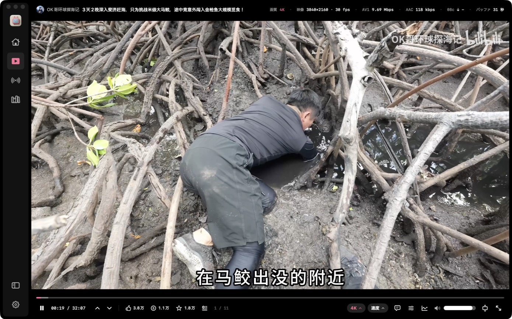
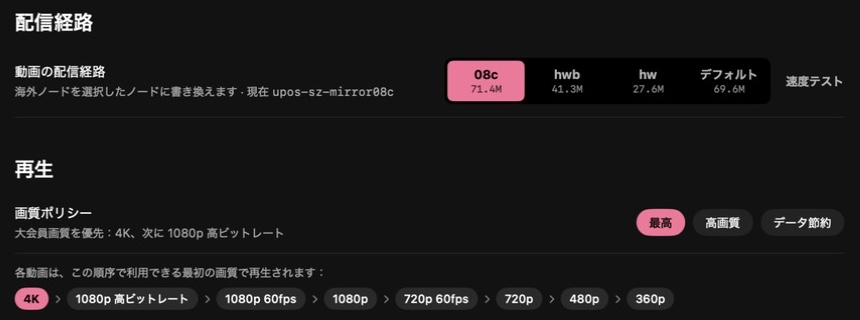
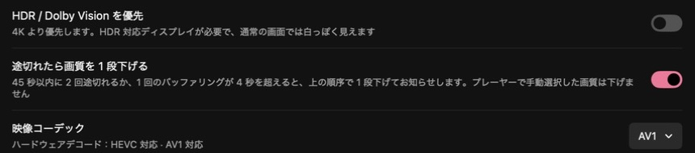
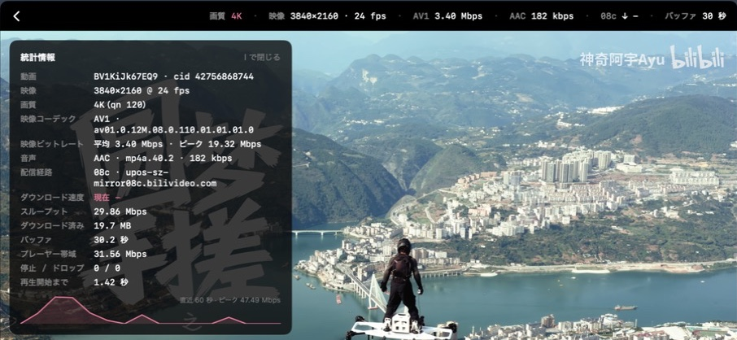
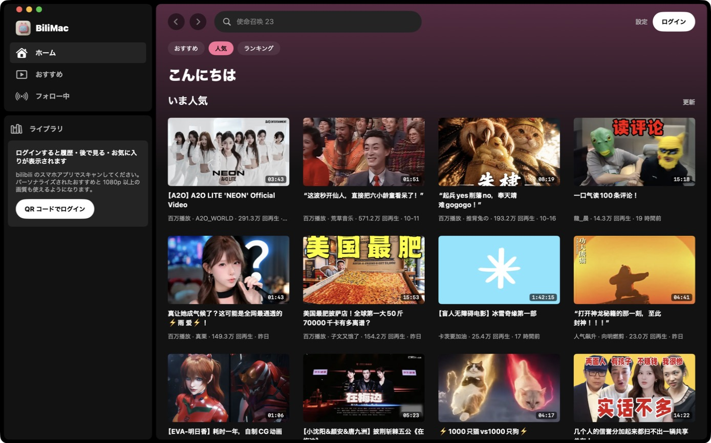
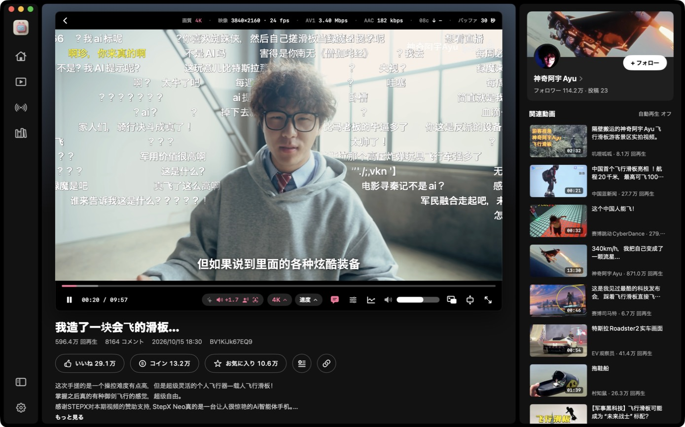
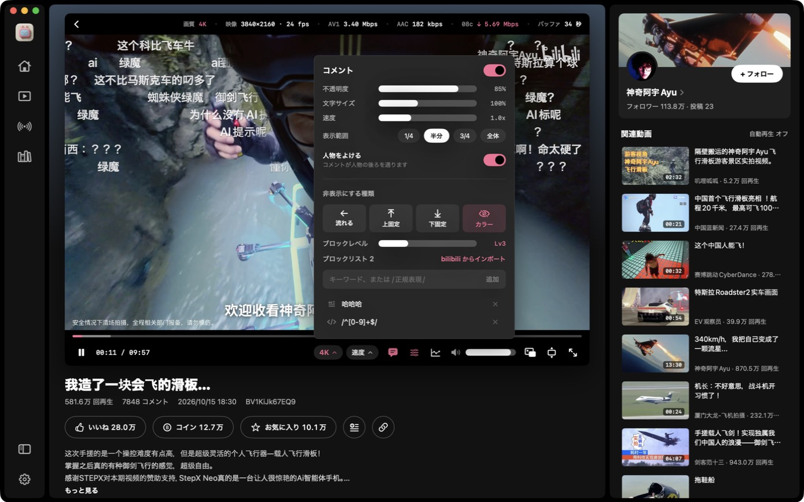
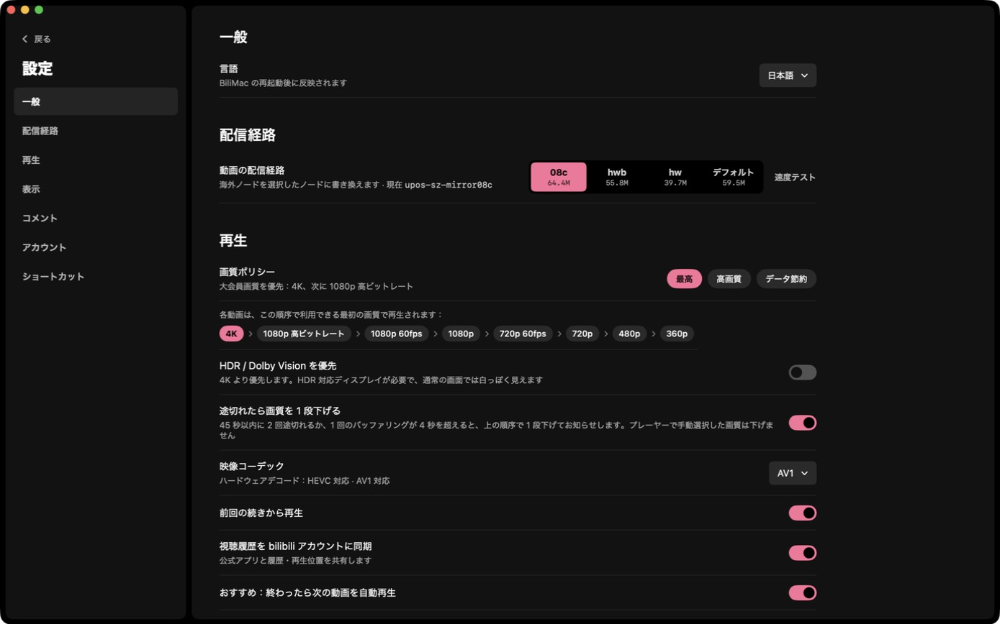

<p align="center"></p>

<h1 align="center">BiliMac</h1>

<p align="center">ネイティブで控えめ、「観る」ことを中心にした bilibili の macOS クライアント</p>

<p align="center"><a href="README.md">English</a> · <a href="README.zh-CN.md">简体中文</a> · <b>日本語</b></p>

<p align="center"><a href="https://github.com/Dime2015/BiliMac/releases/latest"><b>⬇ 最新版をダウンロード</b></a>（macOS 14 以降、Apple シリコン / Intel）</p>



BiliMac は SwiftUI でゼロから書いたアプリで、Web ページのラッパーではありません。再生はシステムの AVPlayer（ハードウェアデコード、4K / HDR / AV1 対応）を使い、UI は Spotify のダークなスタイルを参考にしています。情報はたっぷり、でも映像の邪魔はしません。

> **非公式クライアントです。** 本プロジェクトは bilibili とは一切関係がありません。公開されているものの文書化されていない Web API を使っているため、いつ動かなくなってもおかしくありません。個人利用・学習目的でお使いください。

## BiliMac の特長

### 1. 海外でも大会員の 4K をなるべく止まらずに



中国本土の外から bilibili を開くと、動画は海外 CDN ノード（`cosov` / `aliov` / Akamai など）に割り当てられます。キャッシュされていない部分は **0.3～1 Mbps** しか出ないことが多く、数〜十数 Mbps 必要な 4K は数秒ごとに止まります。

- **配信経路を選ぶ**：動画リクエストを中国国内ノード `08c` / `hwb` / `hw` に書き換えます（日本の家庭回線での実測：08c は約 50 Mbps で安定、既定の海外ノードはキャッシュなしの部分で 1 Mbps 未満。詳細は [B站加速](https://github.com/Dime2015/bilibili-macos-overseas-accelerator)）。設定のワンクリック速度テストで、あなたの回線での各ノードを比較できます。
- **画質ポリシー**：「最高」は 4K → 1080P 高ビットレート → 1080P 60fps → … の順で最初に使える画質を選びます。途切れが続くと 1 段下げてお知らせし、手動で選んだ画質は変更しません。
- **通信状況が見える**：映像の上の情報バーに、使用中のノードとリアルタイムの通信速度を表示します。

### 2. システムレベルの「人物をよける」コメント


bilibili Web 版の「スマート防遮挡」は、一部の人気動画向けに bilibili が事前に作ったマスクに頼っており、多くの動画にはありません。BiliMac は macOS 標準の Vision による人物認識で、映像内の人物をこの Mac 上でリアルタイムに見つけ、コメントが人物の後ろを通るようにします。**どの動画でも使え**、映像はどこにも送信しません。毎秒約 15 フレームを処理し、4K 再生中の追加負荷は CPU 1 コアの約 1 割。コメントパネルでいつでもオン / オフできます。

### 3. いちばん負荷の小さいデコード方式を選べる



BiliMac は Web ページのラッパーではなく、システムの AVPlayer と VideoToolbox のハードウェアデコードで直接再生します。bilibili は多くの動画を AV1・HEVC・AVC の 3 形式で配信しており、BiliMac ではそれを選べます。「自動」は**この Mac がハードウェアでデコードできる形式**を優先し（AV1 をハードウェアデコードできる M3 以降は AV1、それ以外は HEVC）、設定画面には HEVC / AV1 のハードウェアデコード対応状況が表示されます。

同じ 4K 動画を M3 Pro で計測：

| コーデック | ビットレート | CPU |
|---|---|---|
| AV1 | 3.40 Mbps | 6.6% |
| HEVC | 4.69 Mbps | 6.5% |
| AVC | 9.98 Mbps | 12.8% |

AV1 は AVC の 3 分の 1 の帯域で済み、海外回線では特に有効です。ただし M1 / M2 や Intel Mac は AV1 をハードウェアでデコードできないため、HEVC のほうが省電力です。「自動」がこの判断を代わりに行います。

### 4. 公式クライアントにはないもの



- **「映像の外」レイアウト**：タイトルと技術情報は映像の上の黒帯に、操作バーは映像の下に。映像にも字幕にも何も重ならないので、自動で隠す必要もありません。
- **統計情報パネル**（I キー）：コーデック、ビットレート、使用中のノード、リアルタイムの通信速度、経路のスループット、バッファ、停止 / ドロップ、再生開始までの時間、60 秒間の速度グラフ。
- **シークバーの盛り上がりグラフ**：bilibili の「高能进度条」API は終了しているため、BiliMac がコメント密度から盛り上がる場面をローカルで描きます。シークバーにマウスを乗せると表示されます。
- **画質・音声の補正**（すべて任意。操作バーの補正ボタンでいつでも切り替え、ピンクは動作中）：
  - **画質向上（超解像）**：映像を動画より大きく表示しているとき、この Mac で拡大します。720p 以下はまず macOS の AI 超解像（VideoToolbox）、その後 MetalFX で画面の解像度まで。低画質の古い動画や、海外で一段低い画質を選んで帯域を節約しつつ鮮明さを取り戻すのに。M3 Pro で 1 フレーム約 6〜7 ms。
  - **音量の均一化**：bilibili 自身のラウドネス測定値で、動画ごとの音量差をそろえます。
  - **声を聞き取りやすく**：セリフを前に出します。音声エフェクト 2 つで CPU 増加は約 1.5%、音ズレは数ミリ秒以内です。
- **簡体字中国語 / 英語 / 日本語**の UI。ダーク、bilibili ピンクのライト、またはシステムに合わせる。

## スクリーンショット

| ホーム | ライトモード |
|---|---|
|  |  |
| **動画ページ：コメントが人物の後ろを通る** | **コメント設定とブロック** |
|  |  |
| **投稿者ページ** | **設定：配信経路の速度テストと画質ポリシー** |
|  |  |

## 機能

**ブラウズ**
- ホーム：おすすめ / 人気 / ランキング。ログイン中は「続きから視聴」も表示
- おすすめ（フィード）：没入型の連続再生。↑ ↓ やスクロールで切り替え。「次の動画」は小さなリストで表示され、マウスを乗せると展開、しばらくすると隠れて、画面右端に近づくと再び現れます
- フォロー中、履歴、後で見る、お気に入り
- 検索：検索履歴、トレンド、入力候補
- 投稿者ページ：ヘッダー画像、フォロワー / フォロー / いいね / 投稿数、自己紹介、フォローボタン。投稿動画は新着順・再生数順で並べ替えられ、コレクション・シリーズも見られます。アカウントメニューの自分のページもアプリ内で開きます。動画ページやコメントのアイコン・名前、動画カードの右クリックから開けます
- 動画ページ：説明、投稿者、関連動画、コメント。いいね・コイン・お気に入り・後で見る
- QR コードでログイン（bilibili のスマホアプリでスキャン）

**プレーヤー**
- 既定の「映像の外」レイアウトでは、タイトルと投稿者は映像の上の黒帯の左側、技術情報はその右側、シークバーと操作ボタンは映像の下に置かれます。**映像にも字幕にも何も重ならない**ので、自動で隠す必要もありません。従来の、映像に重ねて自動で隠すレイアウトにも切り替えられます
- 情報バー（常に表示 / 自動で隠す / 表示しない）：画質、解像度、フレームレート、映像コーデックとビットレート、音声ビットレート、使用中の CDN ノードとリアルタイムの通信速度、バッファ量
- 統計情報パネル：ビットレートと通信速度のグラフ、CDN ホストごとの速度
- ウインドウ全体に表示（T）とフルスクリーン（F）。Esc で一段ずつ戻ります
- シーク中にサムネイルをプレビュー
- シークバーの盛り上がりグラフ：コメントの密度から動画の盛り上がる場面を表示します（YouTube の「最も再生された部分」のようなもの）。bilibili 公式のデータ提供が終了したため、アプリ内で計算しています
- コメント（弾幕）：不透明度・サイズ・速度・表示範囲を調整でき、公式と同じブロック設定（種類別〈流れる / 上固定 / 下固定 / カラー〉、ブロックレベル、キーワード / 正規表現 / ユーザーのブロックリスト、bilibili アカウントからのインポート）も使えます。設定ボタンはコメント表示切り替えの隣にあります
- 人物をよける：Vision で映像内の人物をこの Mac 上で認識し、コメントが人物の後ろを通ります。bilibili がマスクを用意している一部の動画だけでなく、すべての動画で使えます
- YouTube 風のキーボードショートカット（下表）

**画質と配信経路**
- 画質ポリシー：最高（4K → 1080P 高ビットレート → 1080P60 → …）、高画質、データ節約。HDR / Dolby Vision を優先することも可能
- 途切れが続くと画質を自動で 1 段下げます（手動で選んだ画質は変更しません）
- コーデック：自動（ハードウェアデコード優先）/ HEVC / AVC / AV1
- **動画の配信経路**：中国本土の外からアクセスすると海外 CDN ノードが割り当てられ、キャッシュされていない部分は 1 Mbps を切ることもよくあります。BiliMac は動画リクエストを中国国内ノード `08c` / `hwb` / `hw` に書き換えるか、既定のままにするかを選べます。設定画面の速度テストで各ノードを比較できます。仕組みと実測値は姉妹プロジェクト [B站加速（bilibili macOS overseas accelerator）](https://github.com/Dime2015/bilibili-macos-overseas-accelerator) を参照してください

**外観**：ダーク、bilibili ピンクを基調にしたライト、またはシステムに合わせる（設定 → 一般 → 外観）。プレーヤーは常にダーク表示です。

**言語**：UI は簡体字中国語・英語・日本語に対応しています。既定ではシステムの言語に従い、設定 → 一般 → 言語 で個別に指定することもできます。

## インストール

macOS 14 以降（Apple シリコン・Intel 対応）が必要です。

### ダウンロード

1. [Releases](https://github.com/Dime2015/BiliMac/releases/latest) から `BiliMac-x.y.z.dmg` をダウンロードして開き、BiliMac を「アプリケーション」にドラッグします。
2. BiliMac には Apple の Developer ID がなく（ad-hoc 署名のみ）、初回起動時に「開発元を確認できません」と表示されます。その場合は次のどちらかを行ってください。
   - システム設定 → プライバシーとセキュリティ を開き、下の方にある BiliMac の項目で「このまま開く」をクリックして確認する
   - ターミナルで一度だけ次を実行する

     ```bash
     xattr -dr com.apple.quarantine /Applications/BiliMac.app
     ```

### ソースからビルド

Xcode または Xcode Command Line Tools（`xcode-select --install`）が必要です。

```bash
git clone https://github.com/Dime2015/BiliMac.git
cd BiliMac
./build.sh --install
```

`./build.sh` で `build/BiliMac.app` が作られます。`--install` で `/Applications` にもコピーし、`--dmg` で Apple シリコン + Intel のユニバーサル版 `build/BiliMac-<バージョン>.dmg` を作ります。自分でビルドしたものはそのまま開けます。

## キーボードショートカット

| キー | 操作 |
|---|---|
| Space / K | 再生 / 一時停止 |
| ← / → | 5 秒戻る / 進む |
| J / L | 10 秒戻る / 進む |
| ↑ / ↓ | おすすめでは前 / 次の動画、それ以外では音量 |
| 0 – 9 | 0 % – 90 % の位置へ移動 |
| < / > | 再生速度を下げる / 上げる |
| T | ウインドウ全体に表示 |
| F | フルスクリーン |
| Esc | 全画面表示から一段ずつ戻る |
| D · I · M | コメント · 統計情報 · ミュート |
| ⌘F | 検索 |
| ⌘[ / ⌘] | 戻る / 進む |
| ⌘R | リストを更新 |
| ⌘, | 設定 |

## 仕組み

- bilibili の動画は DASH（映像と音声が別々の fMP4）で配信されています。BiliMac は `127.0.0.1` で小さな HLS プロキシを動かし、SIDX インデックスを読んで fMP4 の HLS プレイリスト（`EXT-X-MAP` + `EXT-X-BYTERANGE`）を作り、セグメントのリクエストを CDN へストリーミングで中継します。これで AVPlayer がそのまま再生でき、ハードウェアデコード・HDR・AV1 もそのまま使えます。
- CDN の書き換えも同じ層で行います。上流のホスト名を設定で選んだノードに置き換え、ホストごとに通信速度を計測します。
- API リクエストは Web 版と同じ方法で WBI 署名しています。
- 純粋な Swift パッケージで、サードパーティの依存も Xcode プロジェクトもありません。

## プライバシー

- ログイン用の Cookie はこの Mac の `~/Library/Application Support/BiliMac/cookies.json`（パーミッション 600）にだけ保存され、bilibili のサーバーにだけ送信されます。
- アクセス解析・トラッキング・サードパーティのサービスは一切使っていません。
- 「視聴履歴を bilibili アカウントに同期」は設定でオフにでき、オフにすると視聴内容は送信されません。

## クレジット

- アプリアイコンは [Grok](https://grok.com) で生成し（プロンプトは [`icon/prompt.md`](icon/prompt.md)）、[`icon/makeicon.swift`](icon/makeicon.swift) で macOS アイコンに切り出しました。
- API 情報はコミュニティがまとめている [bilibili-API-collect](https://github.com/SocialSisterYi/bilibili-API-collect) を参考にしました。
- コードの大部分は [Claude Code](https://claude.com/claude-code) で書かれています。

## ライセンス

[MIT](LICENSE)。「bilibili」「哔哩哔哩」および関連する標章は、それぞれの権利者に帰属します。
