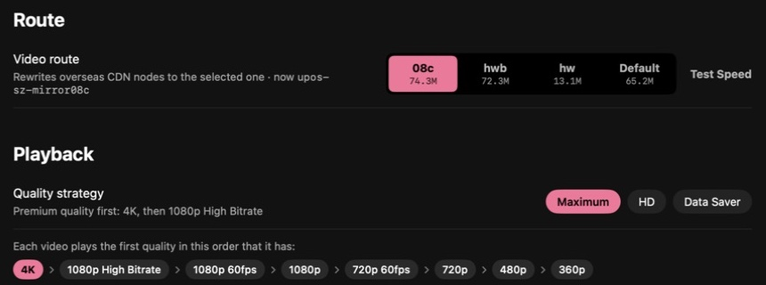
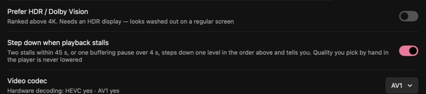
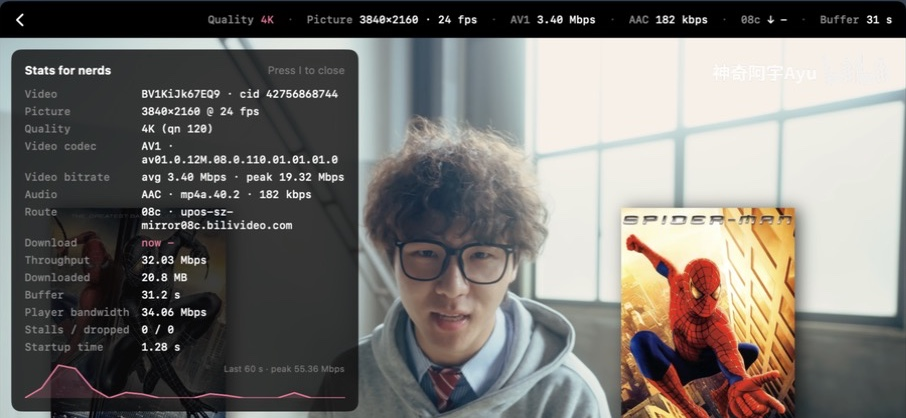
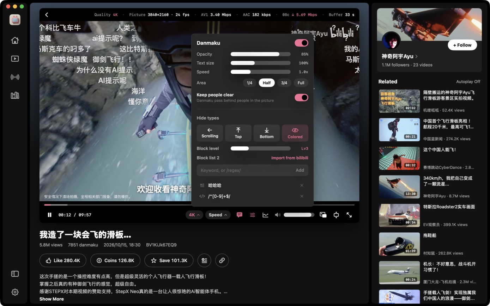

<p align="center"></p>

<h1 align="center">BiliMac</h1>

<p align="center">A native, restrained, watching-first bilibili client for macOS</p>

<p align="center"><b>English</b> · <a href="README.zh-CN.md">简体中文</a> · <a href="README.ja.md">日本語</a></p>

<p align="center"><a href="https://github.com/Dime2015/BiliMac/releases/latest"><b>⬇ Download the latest release</b></a> (macOS 14+, Apple Silicon / Intel)</p>


BiliMac is written from scratch in SwiftUI — not a web wrapper. Playback goes through the system AVPlayer (hardware decoding, 4K / HDR / AV1), and the interface borrows Spotify's dark look: plenty of information, none of it in the way of the picture.

> **Unofficial client.** This project is not affiliated with bilibili in any way. It uses public but undocumented web APIs that may change at any time. For personal and educational use.

## Why BiliMac

### 1. Premium 4K from outside China, without the stutter



Outside mainland China, bilibili hands out overseas CDN nodes (`cosov` / `aliov` / Akamai and others). Segments they haven't cached often crawl at **0.3–1 Mbps**, while 4K needs several to a dozen Mbps — so playback stops every few seconds.

- **Pick the route**: rewrite video requests to the mainland nodes `08c` / `hwb` / `hw` (measured on a home line in Japan: 08c holds ~50 Mbps while the default overseas node gives under 1 Mbps on uncached segments; see [B站加速](https://github.com/Dime2015/bilibili-macos-overseas-accelerator)). A one-click speed test in Settings compares the nodes on your connection.
- **Quality strategy**: "Maximum" plays the first available of 4K → 1080P high bitrate → 1080P 60fps → …; if playback keeps stalling it steps down one level and tells you, and a quality you picked by hand is never changed.
- **See the network**: the info strip above the picture shows the current node and live download speed, so you know whether and why it stalls.

### 2. System-level danmaku that never covers people


The bilibili website's "smart anti-occlusion" relies on masks bilibili precomputes for some popular videos; most videos don't have one. BiliMac uses macOS's own Vision person segmentation to find people in the picture on your Mac, in real time, and lets danmaku pass behind them — **on every video**, with nothing uploaded. It looks at about 15 frames a second, costs roughly a tenth of a CPU core during 4K playback, and can be switched off in the danmaku panel.

### 3. The decoder that costs your Mac the least



BiliMac isn't a web wrapper: playback goes straight through the system's AVPlayer and VideoToolbox hardware decoding. bilibili usually serves each video in AV1, HEVC and AVC; BiliMac lets you choose, and "Auto" prefers the formats **your Mac can decode in hardware**. Settings tells you whether this Mac hardware-decodes HEVC and AV1.

The same 4K video on an M3 Pro:

| Codec | Bitrate | CPU |
|---|---|---|
| AV1 | 3.40 Mbps | 6.6% |
| HEVC | 4.69 Mbps | 6.5% |
| AVC | 9.98 Mbps | 12.8% |

AV1 needs a third of AVC's bandwidth, which helps a lot on overseas connections; but M1 / M2 and Intel Macs can't decode AV1 in hardware, so HEVC is the frugal choice there. "Auto" works this out for you.

### 4. Things the official client doesn't have



- **"Outside the picture" player layout**: title and tech info live in the black bar above the video, controls below it — nothing covers the picture or subtitles, so nothing has to auto-hide.
- **Stats for nerds** (press I): codec, bitrate, current node, live download speed, route throughput, buffer, stalls / dropped frames, startup time, and a 60-second throughput graph.
- **Heat curve on the progress bar**: bilibili retired its heat ("高能进度条") endpoint, so BiliMac draws the busiest moments from danmaku density, shown when you hover the progress bar.
- **Picture and sound enhancements** (all optional; switch them in the bottom bar's enhancement pill — pink means working):
  - **Super resolution**: when the picture is shown larger than the video, it's upscaled on your Mac — 720p and below through macOS's AI super resolution (VideoToolbox) first, then MetalFX to the screen's pixels. Good for old low-res uploads, or for picking a lower quality abroad to save bandwidth and getting the sharpness back. About 6–7 ms a frame on an M3 Pro.
  - **Loudness normalization**: uses bilibili's own loudness measurement to play every video at a similar volume.
  - **Voice boost**: brings dialogue forward. Both audio effects together cost about 1.5% CPU, with audio and picture kept within a few milliseconds.
- **Chinese / English / Japanese** UI; dark, a light theme built on bilibili pink, or follow the system.

## Screenshots

| Home | Light mode |
|---|---|
|  |  |
| **Video page: danmaku pass behind people** | **Danmaku settings & filters** |
|  |  |
| **Creator page** | **Settings: route speed test and quality strategy** |
|  |  |

## Features

**Browse**
- Home: For You / Popular / Rankings, plus "continue watching" when signed in
- Featured: an immersive feed that keeps playing; switch with ↑ ↓ or the scroll wheel. *Up Next* starts as a small list, expands on hover, then tucks away and comes back when the pointer nears the right edge
- Following, History, Watch Later, Favorites
- Search with history, trending searches and suggestions
- Creator pages: banner, follower / following / like / video counts, bio, follow button, their videos sorted by newest or most played, and their collections and series. Your own space (account menu) opens in the app too. Open one from the avatar or name on a video page or in comments, or from a video card's right-click menu
- Video page: description, uploader, related videos, comments; like, coin, save, watch later
- QR-code sign-in (scan with the bilibili mobile app)

**Player**
- The default *Outside the picture* layout puts the title and uploader in the black bar above the video, tech info on the right of that bar, and the progress bar and controls below the video. **Nothing covers the picture or the subtitles**, so nothing has to auto-hide. The classic overlay layout with auto-hide is still available
- Info strip (always / auto-hide / off): quality, resolution, frame rate, video codec and bitrate, audio bitrate, current CDN node with live download speed, buffer length
- *Stats for nerds* panel with bitrate and throughput graphs and live per-CDN-host speeds
- Fill Window (T) and real Full Screen (F); Esc steps back out
- Thumbnail previews while scrubbing
- Heat curve on the progress bar, drawn from danmaku density, that shows the busiest moments (like YouTube's *Most replayed*). bilibili retired its official heat endpoint, so BiliMac computes it locally
- Danmaku (bullet comments) with adjustable opacity, size, speed and area, plus filters like the official player's: by type (scrolling / top / bottom / colored), block level, and a keyword / regex / user block list you can import from your bilibili account. The settings button sits next to the danmaku toggle
- Keep people clear: people in the picture are found on-device with Vision and danmaku pass behind them. Works on every video, not just the ones bilibili ships masks for
- YouTube-style keyboard shortcuts (see below)

**Quality and routes**
- Quality strategy: Maximum (4K → 1080P high bitrate → 1080P60 → …), HD, or Data Saver; optionally prefer HDR / Dolby Vision
- Steps down one level automatically when playback keeps stalling (a quality you picked by hand is never changed)
- Codec preference: Auto (hardware first) / HEVC / AVC / AV1
- **Video route**: outside mainland China, bilibili hands out overseas CDN nodes, and uncached segments there often crawl at under 1 Mbps. BiliMac can rewrite video requests to the mainland nodes `08c` / `hwb` / `hw`, or leave them alone. A built-in speed test compares the nodes. Background and measurements are in the sister project [B站加速 (bilibili macOS overseas accelerator)](https://github.com/Dime2015/bilibili-macos-overseas-accelerator)

**Appearance**: dark, a light theme built on bilibili pink, or follow the system (Settings → General → Appearance). The player always stays dark.

**Languages**: the UI is available in Simplified Chinese, English and Japanese. It follows the system by default; you can override it in Settings → General → Language.

## Install

Requires macOS 14 or later, on Apple Silicon or Intel.

### Download

1. Get `BiliMac-x.y.z.dmg` from [Releases](https://github.com/Dime2015/BiliMac/releases/latest), open it and drag BiliMac into Applications.
2. BiliMac has no Apple Developer ID (it is only ad-hoc signed), so on first launch macOS says it can't verify the developer. Then either:
   - open System Settings → Privacy & Security, find the BiliMac message near the bottom, click **Open Anyway** and confirm; or
   - run this once in Terminal:

     ```bash
     xattr -dr com.apple.quarantine /Applications/BiliMac.app
     ```

### Build from source

Requires Xcode or the Xcode Command Line Tools (`xcode-select --install`).

```bash
git clone https://github.com/Dime2015/BiliMac.git
cd BiliMac
./build.sh --install
```

`./build.sh` produces `build/BiliMac.app`; `--install` also copies it to `/Applications`; `--dmg` builds a universal (Apple Silicon + Intel) `build/BiliMac-<version>.dmg`. A build you made yourself opens normally.

## Keyboard shortcuts

| Key | Action |
|---|---|
| Space / K | Play / pause |
| ← / → | Back / forward 5 s |
| J / L | Back / forward 10 s |
| ↑ / ↓ | Previous / next in Featured, volume elsewhere |
| 0 – 9 | Jump to 0 % – 90 % |
| < / > | Slower / faster |
| T | Fill Window |
| F | Full Screen |
| Esc | Step out of full screen |
| D · I · M | Danmaku · stats · mute |
| ⌘F | Search |
| ⌘[ / ⌘] | Back / forward |
| ⌘R | Refresh list |
| ⌘, | Settings |

## How it works

- bilibili serves DASH (separate fMP4 video and audio). BiliMac runs a tiny HLS proxy on `127.0.0.1`: it reads the SIDX index, builds an fMP4 HLS playlist (`EXT-X-MAP` + `EXT-X-BYTERANGE`) and streams segment requests through to the CDN. AVPlayer then plays it natively, with hardware decoding, HDR and AV1 for free.
- The CDN rewrite happens in the same layer: upstream host names are swapped for the node chosen in Settings, and throughput is measured per host.
- API requests are WBI-signed the same way the website does it.
- A plain Swift package: no third-party dependencies, no Xcode project.

## Privacy

- Your sign-in cookies are stored only on your Mac, in `~/Library/Application Support/BiliMac/cookies.json` (mode 600), and are sent only to bilibili's servers.
- No analytics, tracking or third-party services.
- "Sync watch history to your bilibili account" can be turned off in Settings; when it is off, nothing about what you watch is reported.

## Credits

- The app icon was generated with [Grok](https://grok.com) (prompt in [`icon/prompt.md`](icon/prompt.md)) and cut into a macOS icon by [`icon/makeicon.swift`](icon/makeicon.swift).
- API notes from the community-maintained [bilibili-API-collect](https://github.com/SocialSisterYi/bilibili-API-collect).
- Most of the code was written with [Claude Code](https://claude.com/claude-code).

## License

[MIT](LICENSE). "bilibili", "哔哩哔哩" and related marks belong to their respective owners.
