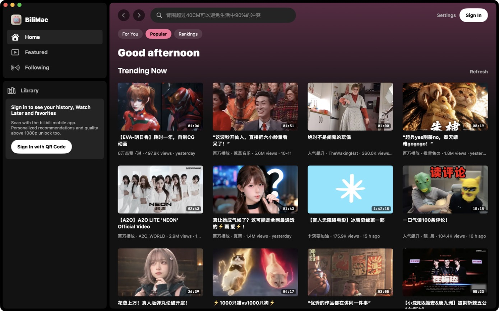
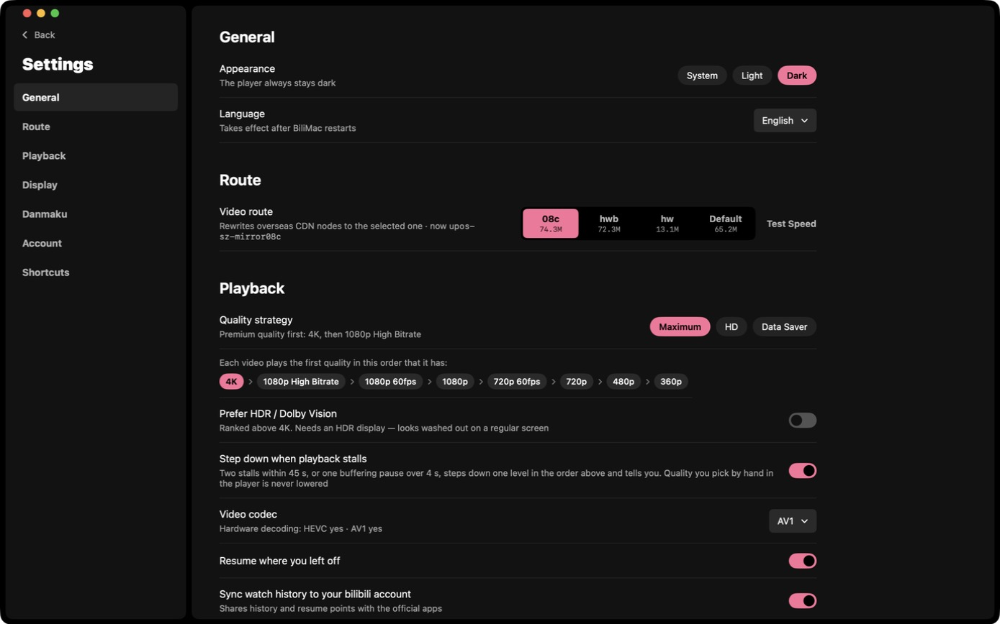

<p align="center"></p>

<h1 align="center">BiliMac</h1>

<p align="center">A native, restrained, watching-first bilibili client for macOS</p>

<p align="center"><b>English</b> · <a href="README.zh-CN.md">简体中文</a> · <a href="README.ja.md">日本語</a></p>


BiliMac is written from scratch in SwiftUI — not a web wrapper. Playback goes through the system AVPlayer (hardware decoding, 4K / HDR / AV1), and the interface borrows Spotify's dark look: plenty of information, none of it in the way of the picture.

> **Unofficial client.** This project is not affiliated with bilibili in any way. It uses public but undocumented web APIs that may change at any time. For personal and educational use.

## Screenshots

| Home | Video |
|---|---|
|  |  |



## Features

**Browse**
- Home: For You / Popular / Rankings, plus "continue watching" when signed in
- Featured: an immersive feed that keeps playing; switch with ↑ ↓ or the scroll wheel. *Up Next* starts as a small list, expands on hover, then tucks away and comes back when the pointer nears the right edge
- Following, History, Watch Later, Favorites
- Search with history, trending searches and suggestions
- Creator pages: banner, follower / following / like / video counts, bio, follow button, and their videos sorted by newest or most played. Open one from the avatar or name on a video page or in comments, or from a video card's right-click menu
- Video page: description, uploader, related videos, comments; like, coin, save, watch later
- QR-code sign-in (scan with the bilibili mobile app)

**Player**
- The default *Outside the picture* layout puts the title and uploader in the black bar above the video, tech info on the right of that bar, and the progress bar and controls below the video. **Nothing covers the picture or the subtitles**, so nothing has to auto-hide. The classic overlay layout with auto-hide is still available
- Info strip (always / auto-hide / off): quality, resolution, frame rate, video codec and bitrate, audio bitrate, current CDN node with live download speed, buffer length
- *Stats for nerds* panel with bitrate and throughput graphs and live per-CDN-host speeds
- Fill Window (T) and real Full Screen (F); Esc steps back out
- Thumbnail previews while scrubbing
- Heat curve on the progress bar, drawn from danmaku density, that shows the busiest moments (like YouTube's *Most replayed*). bilibili retired its official heat endpoint, so BiliMac computes it locally
- Danmaku (bullet comments) with adjustable opacity, size, speed and area, and an option to hide top / bottom comments
- YouTube-style keyboard shortcuts (see below)

**Quality and routes**
- Quality strategy: Maximum (4K → 1080P high bitrate → 1080P60 → …), HD, or Data Saver; optionally prefer HDR / Dolby Vision
- Steps down one level automatically when playback keeps stalling (a quality you picked by hand is never changed)
- Codec preference: Auto (hardware first) / HEVC / AVC / AV1
- **Video route**: outside mainland China, bilibili hands out overseas CDN nodes, and uncached segments there often crawl at under 1 Mbps. BiliMac can rewrite video requests to the mainland nodes `08c` / `hwb` / `hw`, or leave them alone. A built-in speed test compares the nodes. Background and measurements are in the sister project [B站加速 (bilibili macOS overseas accelerator)](https://github.com/Dime2015/bilibili-macos-overseas-accelerator)

**Appearance**: dark, a light theme built on bilibili pink, or follow the system (Settings → General → Appearance). The player always stays dark.

**Languages**: the UI is available in Simplified Chinese, English and Japanese. It follows the system by default; you can override it in Settings → General → Language.

## Install

Requires macOS 14 or later and Xcode or the Xcode Command Line Tools (`xcode-select --install`).

```bash
git clone https://github.com/Dime2015/BiliMac.git
cd BiliMac
./build.sh --install
```

`./build.sh` produces `build/BiliMac.app`; `--install` also copies it to `/Applications`. The app is ad-hoc signed on your machine, so a build you made yourself opens normally.

## Keyboard shortcuts

| Key | Action |
|---|---|
| Space / K | Play / pause |
| ← / → | Back / forward 5 s |
| J / L | Back / forward 10 s |
| ↑ / ↓ | Previous / next in Featured, volume elsewhere |
| 0 – 9 | Jump to 0 % – 90 % |
| < / > | Slower / faster |
| T | Fill Window |
| F | Full Screen |
| Esc | Step out of full screen |
| D · I · M | Danmaku · stats · mute |
| ⌘F | Search |
| ⌘[ / ⌘] | Back / forward |
| ⌘R | Refresh list |
| ⌘, | Settings |

## How it works

- bilibili serves DASH (separate fMP4 video and audio). BiliMac runs a tiny HLS proxy on `127.0.0.1`: it reads the SIDX index, builds an fMP4 HLS playlist (`EXT-X-MAP` + `EXT-X-BYTERANGE`) and streams segment requests through to the CDN. AVPlayer then plays it natively, with hardware decoding, HDR and AV1 for free.
- The CDN rewrite happens in the same layer: upstream host names are swapped for the node chosen in Settings, and throughput is measured per host.
- API requests are WBI-signed the same way the website does it.
- A plain Swift package: no third-party dependencies, no Xcode project.

## Privacy

- Your sign-in cookies are stored only on your Mac, in `~/Library/Application Support/BiliMac/cookies.json` (mode 600), and are sent only to bilibili's servers.
- No analytics, tracking or third-party services.
- "Sync watch history to your bilibili account" can be turned off in Settings; when it is off, nothing about what you watch is reported.

## Credits

- The app icon was generated with [Grok](https://grok.com) (prompt in [`icon/prompt.md`](icon/prompt.md)) and cut into a macOS icon by [`icon/makeicon.swift`](icon/makeicon.swift).
- API notes from the community-maintained [bilibili-API-collect](https://github.com/SocialSisterYi/bilibili-API-collect).
- Most of the code was written with [Claude Code](https://claude.com/claude-code).

## License

[MIT](LICENSE). "bilibili", "哔哩哔哩" and related marks belong to their respective owners.
