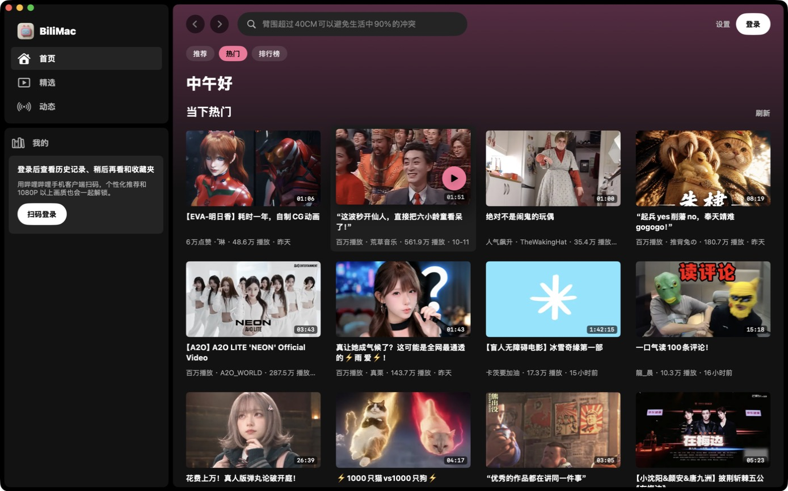
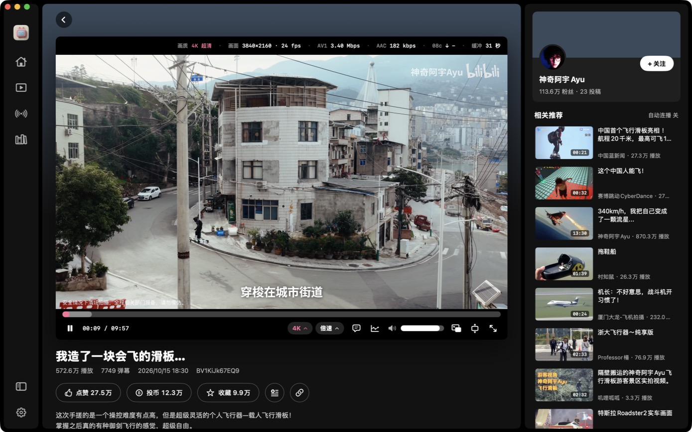
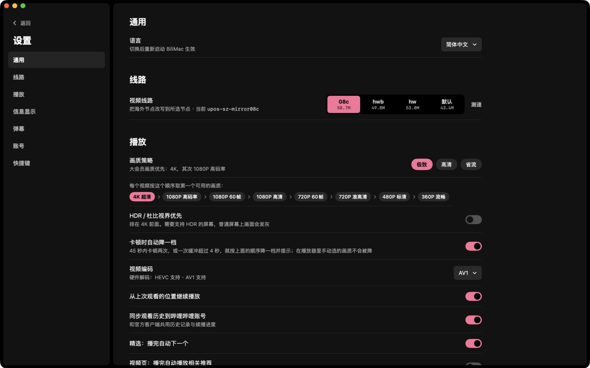

<p align="center"></p>

<h1 align="center">BiliMac</h1>

<p align="center">一个原生、克制、以「看视频」为中心的哔哩哔哩 macOS 客户端</p>

<p align="center"><a href="README.md">English</a> · <b>简体中文</b> · <a href="README.ja.md">日本語</a></p>


BiliMac 用 SwiftUI 从零写成，不是网页套壳。播放走系统的 AVPlayer（硬件解码，支持 4K / HDR / AV1），界面参考了 Spotify 的深色风格：信息给得多，但不打扰画面。

> **非官方客户端。** 本项目与哔哩哔哩（上海宽娱数码科技有限公司）没有任何关系，使用的是公开但未文档化的网页接口，接口随时可能变化。仅供个人学习与使用。

## 截图

| 首页 | 视频页 |
|---|---|
|  |  |



## 功能

**浏览**
- 首页：推荐 / 热门 / 排行榜，登录后有「继续观看」
- 精选：沉浸式连续播放，↑ ↓ 或滚轮切换；「接下来」平时是一个小列表，鼠标移入展开，之后自动隐藏，鼠标靠近右侧边缘时再出现
- 动态、历史、稍后再看、收藏夹
- 搜索：搜索历史、热搜、输入联想
- 视频页：简介、UP 主、相关推荐、评论；点赞、投币、收藏、稍后再看
- 扫码登录（用哔哩哔哩手机 App 扫描）

**播放器**
- 默认「画面外」布局：标题和 UP 主在画面上方的黑条左侧，技术信息在右侧，进度条和控制按钮在画面下方，**任何东西都不压在画面和字幕上**，也就不需要自动隐藏；也可以切换成传统的悬浮自动隐藏布局
- 信息条（可设为一直显示 / 自动隐藏 / 不显示）：画质、分辨率、帧率、视频编码与码率、音频码率、当前 CDN 节点和实时下载速度、缓冲时长
- 统计面板：码率与下载速度曲线、各 CDN 主机的实时速度
- 应用内全屏（铺满窗口，T）和屏幕全屏（F），Esc 逐级退出
- 拖动进度条时显示视频缩略图
- 弹幕：透明度、字号、速度、显示区域可调，可屏蔽顶部 / 底部弹幕
- 借鉴 YouTube 的快捷键（见下表）

**画质与线路**
- 画质策略：极致（4K → 1080P 高码率 → 1080P60 → …）、高清、省流；可优先 HDR / 杜比视界
- 卡顿时自动降一级（手动选择的画质不会被改动）
- 编码偏好：自动（优先硬解）/ HEVC / AVC / AV1
- **视频线路**：海外访问时 B 站会分配海外 CDN 节点，未缓存的片段经常只有不到 1 Mbps。BiliMac 可以把视频请求改写到国内节点 `08c` / `hwb` / `hw`，或者保持默认。设置里有内置测速，可以直接比较各节点。原理和实测数据见姊妹项目 [B站加速](https://github.com/Dime2015/bilibili-macos-overseas-accelerator)。

**语言**：界面支持简体中文、English、日本語，默认跟随系统，也可以在 设置 → 通用 → 语言 里单独指定。

## 安装

需要 macOS 14 或更高版本，以及 Xcode 或 Xcode Command Line Tools（`xcode-select --install`）。

```bash
git clone https://github.com/Dime2015/BiliMac.git
cd BiliMac
./build.sh --install
```

`./build.sh` 会生成 `build/BiliMac.app`；加上 `--install` 会同时复制到 `/Applications`。应用是本地 ad-hoc 签名的，自己构建的版本可以直接打开。

## 快捷键

| 按键 | 作用 |
|---|---|
| 空格 / K | 播放 / 暂停 |
| ← / → | 后退 / 前进 5 秒 |
| J / L | 后退 / 前进 10 秒 |
| ↑ / ↓ | 精选中切换上一个 / 下一个，其它页面调节音量 |
| 0 – 9 | 跳到 0% – 90% 的位置 |
| < / > | 减速 / 加速 |
| T | 应用内全屏 |
| F | 屏幕全屏 |
| Esc | 逐级退出全屏 |
| D · I · M | 弹幕 · 统计信息 · 静音 |
| ⌘F | 搜索 |
| ⌘[ / ⌘] | 后退 / 前进 |
| ⌘R | 刷新列表 |
| ⌘, | 打开设置 |

## 工作原理

- B 站的视频是 DASH（音视频分离的 fMP4）。BiliMac 在 `127.0.0.1` 上起一个小型 HLS 代理：读取 SIDX 索引生成 fMP4 HLS 播放列表（`EXT-X-MAP` + `EXT-X-BYTERANGE`），再把分段请求流式转发到 CDN。这样 AVPlayer 可以原生播放，硬件解码、HDR 和 AV1 都直接可用。
- CDN 改写也在这一层完成：上游请求的主机名会换成设置里选的节点，同时按主机统计下载速度。
- 接口请求按网页端规则做 WBI 签名。
- 纯 Swift Package，没有第三方依赖，没有 Xcode 工程。

## 隐私

- 登录 Cookie 只保存在本机 `~/Library/Application Support/BiliMac/cookies.json`（权限 600），只会发送给 bilibili 的服务器。
- 没有任何统计、埋点或第三方服务。
- 「同步观看历史到哔哩哔哩账号」可以在设置里关闭，关闭后不会上报观看记录。

## 致谢

- 应用图标由 [Grok](https://grok.com) 生成（提示词见 [`icon/prompt.md`](icon/prompt.md)），再用 [`icon/makeicon.swift`](icon/makeicon.swift) 裁切成 macOS 图标。
- 接口资料参考了社区整理的 [bilibili-API-collect](https://github.com/SocialSisterYi/bilibili-API-collect)。
- 本项目大部分代码由 [Claude Code](https://claude.com/claude-code) 编写。

## 许可

[MIT](LICENSE)。「哔哩哔哩」「bilibili」及相关标志归其各自所有者所有。
