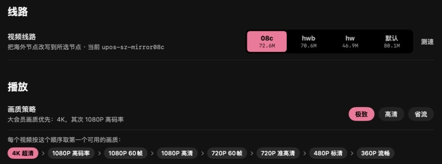
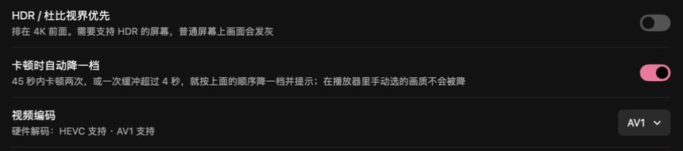
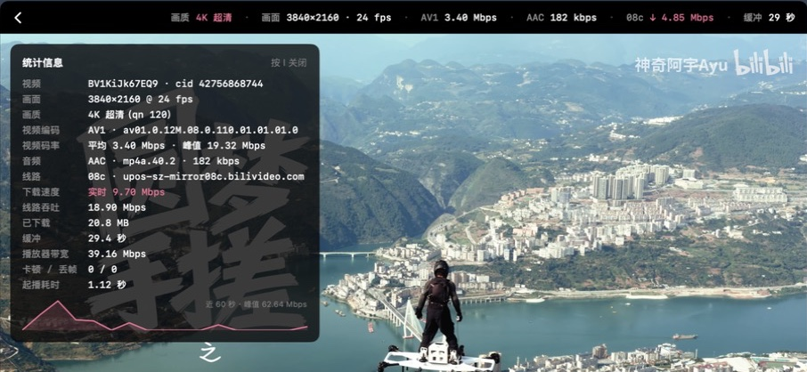
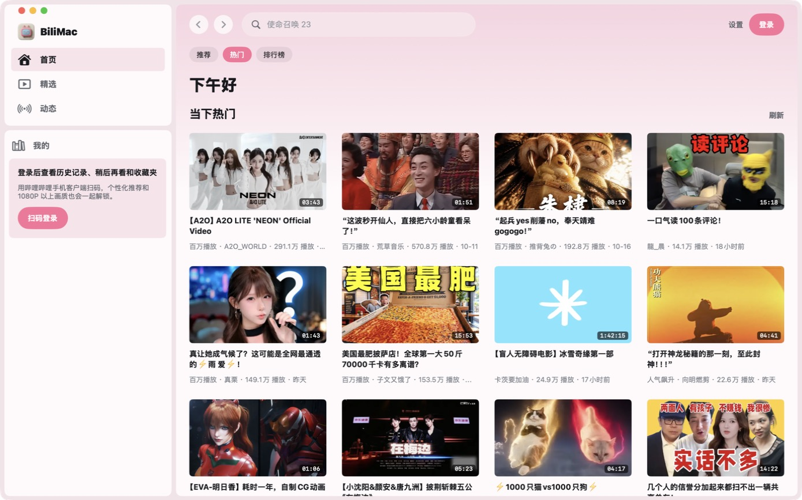
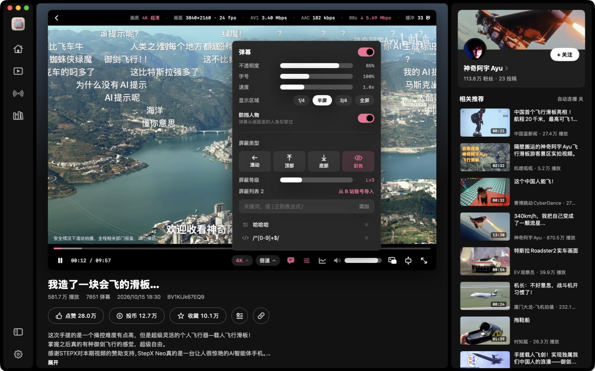
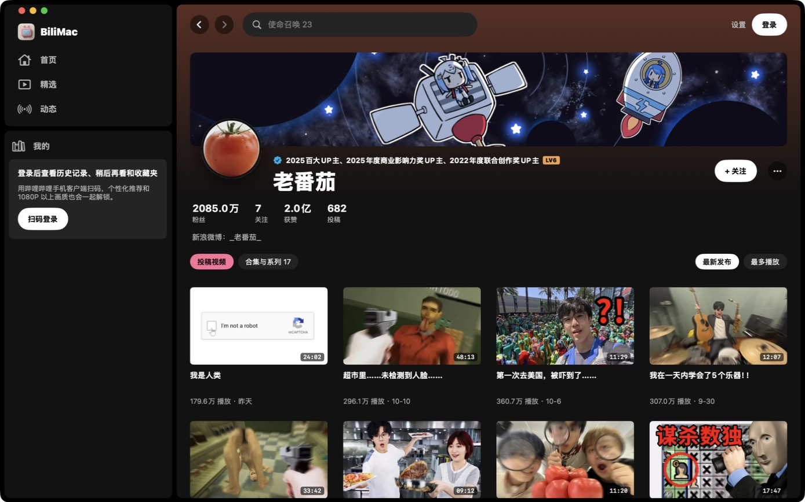

<p align="center"></p>

<h1 align="center">BiliMac</h1>

<p align="center">一个原生、克制、以「看视频」为中心的哔哩哔哩 macOS 客户端</p>

<p align="center"><a href="README.md">English</a> · <b>简体中文</b> · <a href="README.ja.md">日本語</a></p>

<p align="center"><a href="https://github.com/Dime2015/BiliMac/releases/latest"><b>⬇ 下载最新版</b></a>（macOS 14+，Apple 芯片 / Intel）</p>


BiliMac 用 SwiftUI 从零写成，不是网页套壳。播放走系统的 AVPlayer（硬件解码，支持 4K / HDR / AV1），界面参考了 Spotify 的深色风格：信息给得多，但不打扰画面。

> **非官方客户端。** 本项目与哔哩哔哩（上海宽娱数码科技有限公司）没有任何关系，使用的是公开但未文档化的网页接口，接口随时可能变化。仅供个人学习与使用。

## 为什么用 BiliMac

### 1. 海外看大会员 4K，尽量不卡



在海外打开 B 站，视频会被分配到海外 CDN 节点（`cosov` / `aliov` / Akamai 等），没缓存过的片段经常只有 **0.3～1 Mbps**，而 4K 需要几到十几 Mbps，结果就是看几秒卡一下。

- **选线路**：把视频请求改写到国内节点 `08c` / `hwb` / `hw`（日本家宽实测 08c 稳定在 ~50 Mbps，海外默认节点未缓存片段只有不到 1 Mbps，数据见 [B站加速](https://github.com/Dime2015/bilibili-macos-overseas-accelerator)）。设置里有一键测速，直接比较各节点在你网络下的速度。
- **画质策略**：「极致」按 4K → 1080P 高码率 → 1080P 60 帧 → … 的顺序取第一个能播的画质；卡顿时自动降一档并告诉你，手动选的画质不会被改动。
- **看得见网速**：画面上方的信息条实时显示当前节点和下载速度，卡不卡、卡在哪一目了然。

### 2. 系统原生级的弹幕防遮挡


B 站网页版的「智能防挡弹幕」依赖服务器给部分热门视频预先生成的蒙版，很多视频没有。BiliMac 直接用 macOS 自带的 Vision 人物识别，在你的 Mac 上实时找出画面里的人，让弹幕从人身后穿过——**任何视频都能用**，不上传任何画面。每秒识别约 15 帧，4K 播放时大约多用 0.1 个 CPU 核心，可在弹幕面板里随时开关。

### 3. 选最省资源的解码方式



BiliMac 不是网页套壳：播放直接走系统的 AVPlayer 和 VideoToolbox 硬件解码。同一个视频 B 站通常同时提供 AV1、HEVC、AVC 三种编码，BiliMac 让你选，默认「自动」优先选**你这台 Mac 能硬解**的格式；设置里会直接告诉你本机是否支持 HEVC / AV1 硬解。

同一个 4K 视频在 M3 Pro 上实测：

| 编码 | 码率 | CPU 占用 |
|---|---|---|
| AV1 | 3.40 Mbps | 6.6% |
| HEVC | 4.69 Mbps | 6.5% |
| AVC | 9.98 Mbps | 12.8% |

AV1 只要 AVC 三分之一的带宽，海外网络下格外有用；但 M1 / M2 和 Intel Mac 不能硬解 AV1，这些机器上选 HEVC 才省电省 CPU。「自动」会替你判断。

### 4. 官方客户端没有的



- **「画面外」播放器布局**：标题、技术信息在画面上方的黑条里，控制栏在画面下方，什么都不压在画面和字幕上，也就不用自动隐藏。
- **统计信息面板**（按 I）：编码、码率、当前节点、实时下载速度、线路吞吐、缓冲、卡顿 / 丢帧、起播耗时，以及 60 秒速度曲线。
- **进度条热度曲线**：B 站的高能进度条接口已经下线，BiliMac 按弹幕密度在本地画出视频里最热闹的片段，鼠标移到进度条上就能看到。
- **画质与音效增强**（都是可选项，底栏的「增强」按钮里随时开关，粉色表示正在工作）：
  - **画质增强**：画面比视频大时在本机放大——720P 及以下先用 macOS 的 AI 超分（VideoToolbox），再用 MetalFX 放大到屏幕像素。适合低清老视频，也适合在海外选低一档画质省带宽再补回清晰度。M3 Pro 上每帧约 6–7 ms。
  - **响度均衡**：用 B 站自己测得的响度把每个视频拉到相近音量，切视频不用再调音量。
  - **人声增强**：突出对白、压低背景，适合口播和 Vlog。两项音效合计只多用约 1.5% CPU，音画同步误差在几毫秒内。
- **简体中文 / English / 日本語**界面，深色、以 B 站粉为主的浅色，或跟随系统。

## 截图

| 首页 | 浅色模式 |
|---|---|
|  |  |
| **视频页：弹幕从人身后穿过** | **弹幕设置与屏蔽** |
|  |  |
| **UP 主主页** | **设置：线路测速与画质策略** |
|  |  |

## 功能

**浏览**
- 首页：推荐 / 热门 / 排行榜，登录后有「继续观看」
- 精选：沉浸式连续播放，↑ ↓ 或滚轮切换；「接下来」平时是一个小列表，鼠标移入展开，之后自动隐藏，鼠标靠近右侧边缘时再出现
- 动态、历史、稍后再看、收藏夹
- 搜索：搜索历史、热搜、输入联想
- UP 主主页：头图、粉丝 / 关注 / 获赞 / 投稿数、简介、关注按钮，投稿可按最新发布或最多播放排序，还有合集与系列；账号菜单里的「个人空间」也在 App 内打开；在视频页点 UP 主头像或名字、在评论里点头像或名字、在视频卡片右键都能进入
- 视频页：简介、UP 主、相关推荐、评论；点赞、投币、收藏、稍后再看
- 扫码登录（用哔哩哔哩手机 App 扫描）

**播放器**
- 默认「画面外」布局：标题和 UP 主在画面上方的黑条左侧，技术信息在右侧，进度条和控制按钮在画面下方，**任何东西都不压在画面和字幕上**，也就不需要自动隐藏；也可以切换成传统的悬浮自动隐藏布局
- 信息条（可设为一直显示 / 自动隐藏 / 不显示）：画质、分辨率、帧率、视频编码与码率、音频码率、当前 CDN 节点和实时下载速度、缓冲时长
- 统计面板：码率与下载速度曲线、各 CDN 主机的实时速度
- 应用内全屏（铺满窗口，T）和屏幕全屏（F），Esc 逐级退出
- 拖动进度条时显示视频缩略图
- 进度条热度曲线：按弹幕密度画出视频里最热闹的片段（类似 YouTube 的「最常重播」）；B 站官方的高能进度条接口已经下线，所以由本地计算
- 弹幕：透明度、字号、速度、显示区域可调；和官方一样的屏蔽设定：按类型（滚动 / 顶部 / 底部 / 彩色）、屏蔽等级、关键词 / 正则 / 用户屏蔽列表，还能从 B 站账号导入。入口在弹幕开关旁边
- 防挡人物：在本机用 Vision 识别画面里的人，弹幕从人身后穿过；所有视频都能用，不依赖 B 站只给部分视频提供的蒙版
- 借鉴 YouTube 的快捷键（见下表）

**画质与线路**
- 画质策略：极致（4K → 1080P 高码率 → 1080P60 → …）、高清、省流；可优先 HDR / 杜比视界
- 卡顿时自动降一级（手动选择的画质不会被改动）
- 编码偏好：自动（优先硬解）/ HEVC / AVC / AV1
- **视频线路**：海外访问时 B 站会分配海外 CDN 节点，未缓存的片段经常只有不到 1 Mbps。BiliMac 可以把视频请求改写到国内节点 `08c` / `hwb` / `hw`，或者保持默认。设置里有内置测速，可以直接比较各节点。原理和实测数据见姊妹项目 [B站加速](https://github.com/Dime2015/bilibili-macos-overseas-accelerator)。

**外观**：深色、以 B 站粉为主的浅色，或跟随系统（设置 → 通用 → 外观）；播放器始终保持深色。

**语言**：界面支持简体中文、English、日本語，默认跟随系统，也可以在 设置 → 通用 → 语言 里单独指定。

## 安装

需要 macOS 14 或更高版本，Apple 芯片和 Intel 都支持。

### 直接下载

1. 在 [Releases](https://github.com/Dime2015/BiliMac/releases/latest) 下载 `BiliMac-x.y.z.dmg`，打开后把 BiliMac 拖进「应用程序」。
2. BiliMac 没有 Apple 开发者证书（只有 ad-hoc 签名），第一次打开时 macOS 会提示无法验证开发者。这时：
   - 打开 系统设置 → 隐私与安全性，在页面下方找到 BiliMac 的提示，点「仍要打开」并确认；
   - 或者在终端里运行一次：

     ```bash
     xattr -dr com.apple.quarantine /Applications/BiliMac.app
     ```

### 从源码构建

需要 Xcode 或 Xcode Command Line Tools（`xcode-select --install`）。

```bash
git clone https://github.com/Dime2015/BiliMac.git
cd BiliMac
./build.sh --install
```

`./build.sh` 生成 `build/BiliMac.app`；`--install` 同时复制到 `/Applications`；`--dmg` 生成 Apple 芯片 + Intel 通用版的 `build/BiliMac-<版本>.dmg`。自己构建的版本可以直接打开。

## 快捷键

| 按键 | 作用 |
|---|---|
| 空格 / K | 播放 / 暂停 |
| ← / → | 后退 / 前进 5 秒 |
| J / L | 后退 / 前进 10 秒 |
| ↑ / ↓ | 精选中切换上一个 / 下一个，其它页面调节音量 |
| 0 – 9 | 跳到 0% – 90% 的位置 |
| < / > | 减速 / 加速 |
| T | 应用内全屏 |
| F | 屏幕全屏 |
| Esc | 逐级退出全屏 |
| D · I · M | 弹幕 · 统计信息 · 静音 |
| ⌘F | 搜索 |
| ⌘[ / ⌘] | 后退 / 前进 |
| ⌘R | 刷新列表 |
| ⌘, | 打开设置 |

## 工作原理

- B 站的视频是 DASH（音视频分离的 fMP4）。BiliMac 在 `127.0.0.1` 上起一个小型 HLS 代理：读取 SIDX 索引生成 fMP4 HLS 播放列表（`EXT-X-MAP` + `EXT-X-BYTERANGE`），再把分段请求流式转发到 CDN。这样 AVPlayer 可以原生播放，硬件解码、HDR 和 AV1 都直接可用。
- CDN 改写也在这一层完成：上游请求的主机名会换成设置里选的节点，同时按主机统计下载速度。
- 接口请求按网页端规则做 WBI 签名。
- 纯 Swift Package，没有第三方依赖，没有 Xcode 工程。

## 隐私

- 登录 Cookie 只保存在本机 `~/Library/Application Support/BiliMac/cookies.json`（权限 600），只会发送给 bilibili 的服务器。
- 没有任何统计、埋点或第三方服务。
- 「同步观看历史到哔哩哔哩账号」可以在设置里关闭，关闭后不会上报观看记录。

## 致谢

- 应用图标由 [Grok](https://grok.com) 生成（提示词见 [`icon/prompt.md`](icon/prompt.md)），再用 [`icon/makeicon.swift`](icon/makeicon.swift) 裁切成 macOS 图标。
- 接口资料参考了社区整理的 [bilibili-API-collect](https://github.com/SocialSisterYi/bilibili-API-collect)。
- 本项目大部分代码由 [Claude Code](https://claude.com/claude-code) 编写。

## 许可

[MIT](LICENSE)。「哔哩哔哩」「bilibili」及相关标志归其各自所有者所有。
